# "Bulutli texnologiyalar" fanidan loyiha hisoboti

**Talaba:** Ismoilova Jasmina · **Guruh:** ATT 01-24 · **O'qituvchi:** Uzoqov L.

## 1. Loyiha nomi va turi

**OmborHub** — omborlarni boshqarish tizimi (**WMS**), ko'p kompaniyali SaaS.

Manzil: <https://vangogh.uz>

## 2. Loyihaning vazifasi

Kompaniyalarga omborlar, yacheykalar, tovar qoldiqlari, kirim, terish va jo'natish, ko'chirish,
inventarizatsiya va hisobotlarni bitta tizimda yuritish imkonini beradi. Har bir kompaniyaning
ma'lumotlari boshqalaridan ajratilgan. Landing sahifa orqali yangi mijozlar ariza qoldiradi.

## 3. Dasturlash tili va framework

| Qatlam | Texnologiya |
|---|---|
| Backend | Python 3.12, Django 5.2 |
| Frontend | HTML, CSS, JavaScript (frameworksiz) |
| Ma'lumotlar bazasi | PostgreSQL 16 |
| Ilova serveri | Gunicorn |
| Load balancer | Nginx |
| Konteynerlar | Docker, Docker Swarm |
| CI/CD | GitHub Actions |

## 4. Bulut provayderi va xizmatlar

Provayder: **Amazon Web Services**, region **ap-southeast-2 (Sidney)**. Akkaunt tashkilot siyosati
bilan shu regionga cheklangan. Faqat Free Tier / kredit doirasidagi xizmatlar ishlatilgan.

| Xizmat | Vazifasi |
|---|---|
| Amazon EC2 (t3.micro) | Ilova serveri: Nginx, Django konteynerlari, autoscaler |
| Elastic IP | O'zgarmas public IP, domen shu IP ga yo'naltirilgan |
| Amazon RDS (PostgreSQL) | Boshqariladigan ma'lumotlar bazasi |
| AWS Secrets Manager | RDS paroli (har 7 kunda avtomatik almashadi) |
| AWS Systems Manager | Serverga SSH siz, kalitsiz kirish |
| Amazon S3 | Mahsulot rasmlari va ombor hujjatlari (nakladnoy, skan) |
| IAM | EC2 role (minimal ruxsatlar) |
| Security Groups | Tarmoq darajasidagi himoya |
| CloudWatch + SNS | Metrikalar, loglar, alarmlar, dashboard, email xabarnoma |
| AWS Budgets | Xarajat nazorati |

## 5. Bulut arxitekturasi

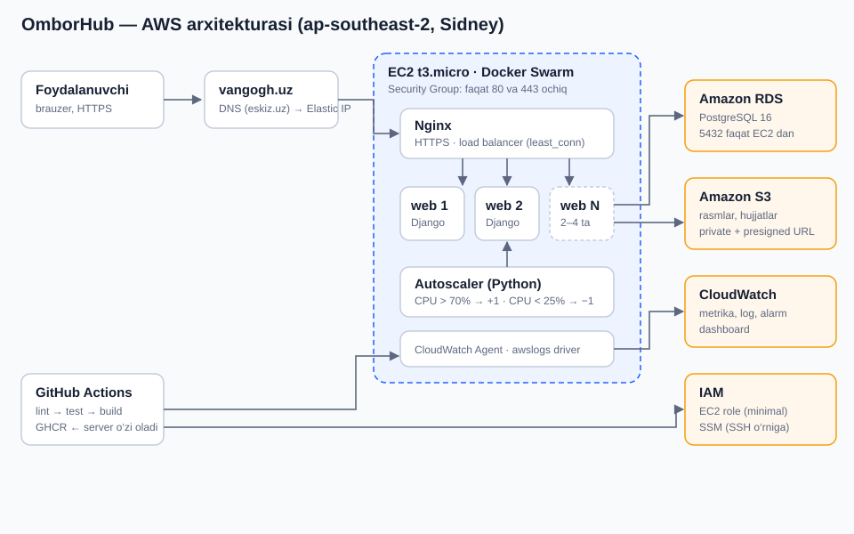

```
Foydalanuvchi → Internet → vangogh.uz (DNS) → Elastic IP → EC2
EC2: Nginx (HTTPS, load balancer) → Django/Gunicorn replikalari (2–4 ta, Docker Swarm)
Django → Amazon RDS (PostgreSQL, 5432-port faqat EC2 dan)
Django → Amazon S3 (IAM role orqali, presigned URL bilan ochiladi)
EC2 / konteynerlar → CloudWatch (metrikalar, loglar, alarmlar)
GitHub Actions → GHCR ← EC2 deploy agenti (har daqiqada yangi versiyani o'zi oladi)
```

## 6. Qismlar tavsifi

### 6.1. Compute — EC2

- Ubuntu 24.04, t3.micro (2 vCPU, 1 GB RAM), 1 GB swap.
- Docker Swarm (bitta tugun) uchta servisni boshqaradi:
  - `nginx` — HTTPS (Let's Encrypt), statik fayllar, so'rovlarni replikalarga taqsimlash
    (`least_conn`);
  - `web` — Django + Gunicorn, 2 tadan 3 tagacha replika, har biri 0.5 CPU / 200 MB bilan
    cheklangan;
  - `autoscaler` — har 30 soniyada CPU ni o'lchab, replikalar sonini o'zgartiradi.
- **Load balancing:** Nginx `tasks.web` DNS yozuvi orqali barcha replikalarni topadi va
  so'rovlarni eng kam band replikaga yuboradi. Javobdagi `X-Served-By` sarlavhasi qaysi replika
  javob berganini ko'rsatadi.
- **Autoscaling:** o'rtacha CPU 70% dan oshsa, replika qo'shiladi, 25% dan tushsa — kamaytiriladi
  (min 2, max 3). Har bir qaror CloudWatch Logs ga yoziladi.
- **Rolling update:** yangi versiya avval ishga tushadi va healthcheck'dan o'tadi, keyin eskisi
  o'chadi. Xato bo'lsa, avtomatik oldingi versiyaga qaytadi.

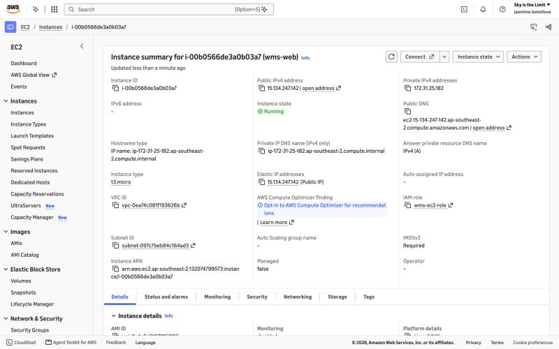
*1-rasm. EC2 instance: t3.micro, holati Running, Elastic IP 15.134.247.142, IAM role `wms-ec2-role`.*

### 6.2. Database — RDS

- PostgreSQL 18, db.t4g.micro, 20 GB, Single-AZ, avtomatik backup.
- **Public access: No** — baza Internetdan ko'rinmaydi, faqat `wms-db-sg` orqali EC2 dan.
- Ulanish SSL bilan (`sslmode=require`). Parol hech qayerga yozilmagan: ilova uni Secrets
  Manager'dan IAM role orqali oladi. RDS parolni har 7 kunda almashtiradi — ilova yangisini
  avtomatik qayta oladi (`apps/core/db/base.py`).
- `/health/` sahifasi bazaga ulanishni tekshiradi: `{"status": "ok", "database": true, ...}`.

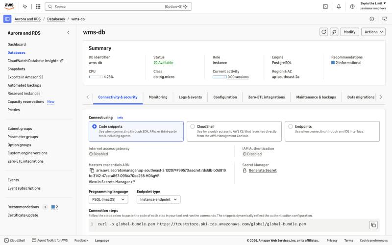
*2-rasm. RDS `wms-db`: PostgreSQL, db.t4g.micro, Internet access gateway — Disabled, parol Secrets Manager'da.*

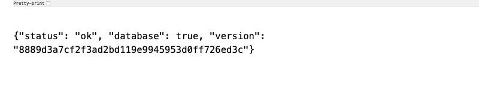
*3-rasm. `https://vangogh.uz/health/` — ilova bazaga ulangan (`"database": true`).*

### 6.3. Storage — S3

- Bucket: `wms-vangogh-files-132074799573`, Block Public Access yoqilgan, SSE-S3 shifrlash.
- Saqlanadi: mahsulot rasmlari (`companies/<id>/products/`) va hujjatlarga biriktirilgan fayllar
  (`companies/<id>/documents/`).
- Django uchun S3 storage `boto3` orqali yozilgan (`apps/core/storage.py`). Fayl 1 soatlik
  imzolangan havola (presigned URL) bilan ochiladi. Havola faqat foydalanuvchining shu hujjatga
  ruxsati tekshirilgandan keyin beriladi.

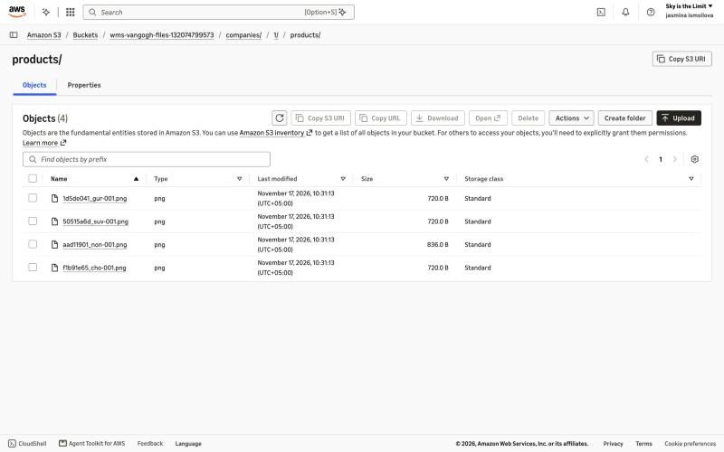
*4-rasm. Ilova yuklagan mahsulot rasmlari: `companies/<kompaniya id>/products/`.*

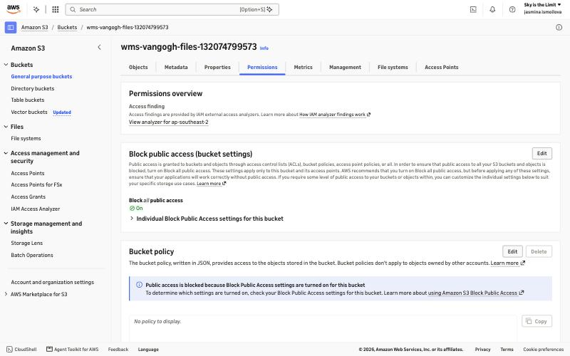
*5-rasm. Block all public access — On. Fayllar faqat imzolangan havola orqali ochiladi
(to'g'ridan-to'g'ri havola 403 qaytaradi).*

### 6.4. Security

| Port | Kimga ochiq | Vazifasi |
|---|---|---|
| 80 (HTTP) | Hamma | HTTPS ga yo'naltirish, sertifikat tekshiruvi |
| 443 (HTTPS) | Hamma | Sayt |
| 5432 (PostgreSQL) | Faqat `wms-web-sg` | EC2 → RDS |

IAM (eng kam ruxsat tamoyili):

- SSH (22) porti **yopiq**. Serverga AWS Systems Manager orqali kiriladi — kalit ham, ochiq
  port ham kerak emas.
- `wms-ec2-role`: faqat bitta S3 bucket, faqat RDS secret'ini o'qish, CloudWatch'ga yozish va
  Systems Manager. Access key yo'q — vaqtinchalik kalitlarni EC2 o'zi oladi.
- GitHub'da hech qanday AWS yoki SSH kaliti saqlanmaydi (pull-deploy).
- Root akkaunt va admin user da MFA yoqilgan.

Ilova darajasida: HTTPS va HSTS, CSRF himoyasi, xavfsiz cookie, parollar hash qilingan, kompaniya
ma'lumotlari ajratilgan (testlar bilan tekshirilgan), ariza formasida honeypot va IP bo'yicha limit,
konteynerlar root bo'lmagan foydalanuvchi nomidan ishlaydi.

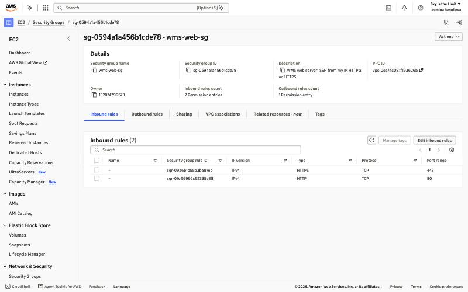
*6-rasm. `wms-web-sg`: faqat 80 va 443 portlar ochiq, SSH yopiq.*

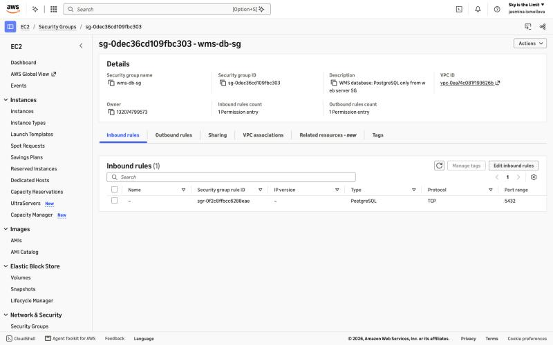
*7-rasm. `wms-db-sg`: 5432 port faqat `wms-web-sg` dan.*

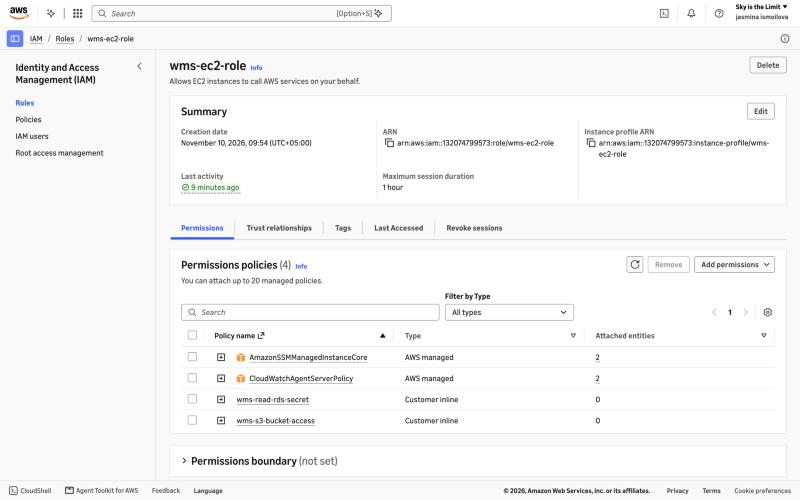
*8-rasm. `wms-ec2-role`: S3 va RDS secret uchun alohida minimal inline policy'lar.*

### 6.5. Monitoring — CloudWatch

- Metrikalar: EC2 CPU, tarmoq va status check, RDS CPU, ulanishlar soni va bo'sh joy.
- Loglar: barcha konteyner loglari `awslogs` driver orqali `/wms/app` log guruhiga.
- Alarmlar (SNS → email): EC2 CPU > 80%, status check xatosi, RDS bo'sh joy < 2 GB.
- Dashboard: `WMS` — grafiklar, alarm holatlari va autoscaler qarorlari bitta sahifada.

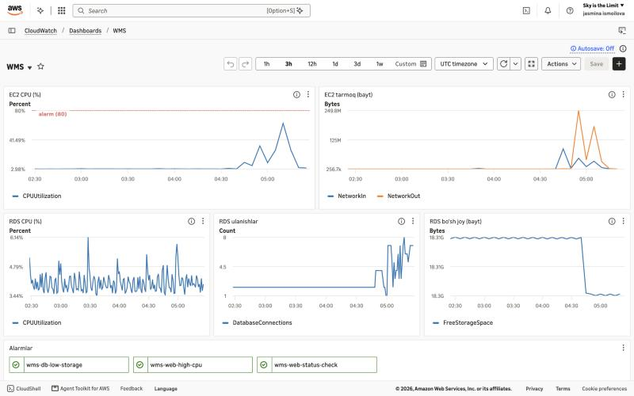
*9-rasm. CloudWatch `WMS` dashboard: yuklama testi paytida CPU va tarmoq cho'qqisi.*

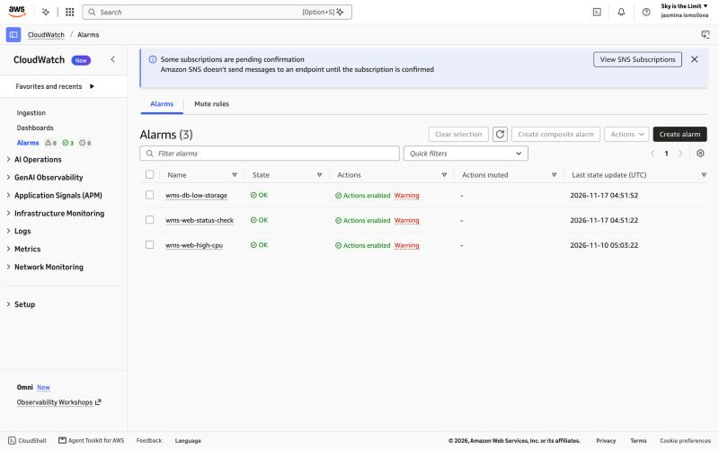
*10-rasm. Uchta alarm, hammasi OK holatda, SNS orqali emailga ulangan.*

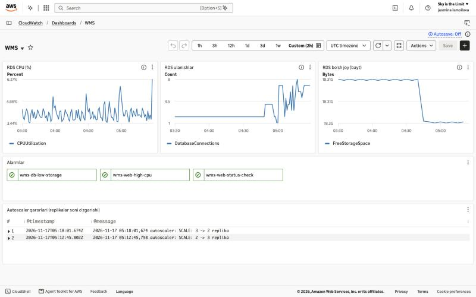
*11-rasm. Autoscaler qarorlari: yuklama oshganda `SCALE: 2 -> 3`, tushganda `SCALE: 3 -> 2`.*

**Yuklama testi natijalari** (`deploy/loadtest.py`, 40 oqim, 4 daqiqa):

| Ko'rsatkich | Qiymat |
|---|---|
| Jami so'rovlar | 18 772 (78 so'rov/s) |
| Xatolar | 0 |
| O'rtacha / 95% javob vaqti | 512 ms / 762 ms |
| Replika 1 / 2 / 3 | 7 538 / 7 310 / 3 924 so'rov |
| Autoscaler | CPU 98% → 2 dan 3 replikaga; yuklama tushgach yana 2 ga |

## 7. CI/CD

GitHub Actions (`.github/workflows/ci-cd.yml`):

1. **lint** — `black`, `flake8`
2. **test** — PostgreSQL bilan Django testlari, migratsiyalar tekshiruvi
3. **build** — 3 ta Docker image (web, nginx, autoscaler) → GitHub Container Registry
4. **serverdagi agent** (systemd timer, har daqiqada) yangi image'ni ko'radi → migratsiya →
   `docker stack deploy` (rolling update, sayt to'xtamaydi)
5. **verify** — `https://vangogh.uz/health/` da yangi commit SHA chiqquncha kutadi

Tashkilot siyosati GitHub'ning AWS ga OIDC orqali kirishini taqiqlagani uchun "pull" usuli
tanlandi. Natijada GitHub'da kalit saqlanmaydi va serverga kiruvchi port kerak emas.

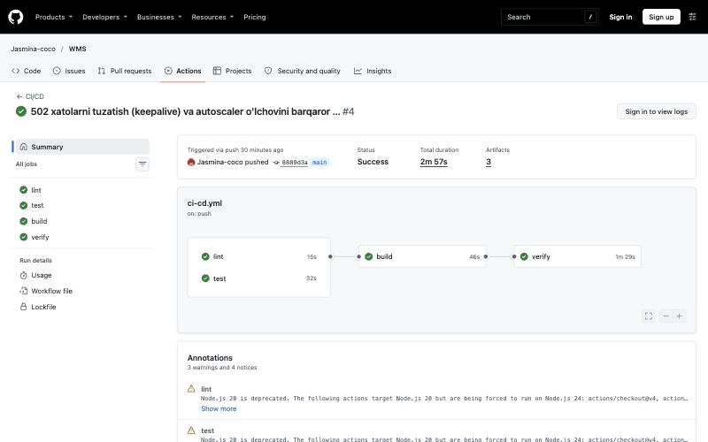
*12-rasm. CI/CD: lint → test → build → verify (server yangi versiyaga o'tganini tasdiqlash).*

## 8. Ilova

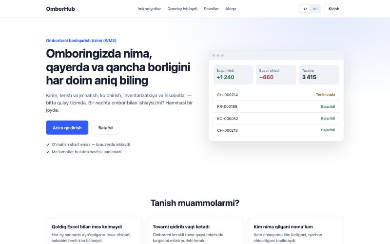
*13-rasm. `https://vangogh.uz` — landing sahifa, HTTPS.*

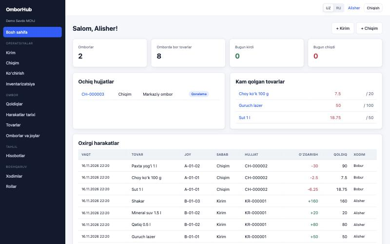
*14-rasm. Tizim ichi: ombor menejeri bosh sahifasi (demo ma'lumotlar bilan lokal nusxa).*

## 9. Xarajatlar

Kreditli Free plan ($133 kredit). Taxminiy oylik sarf: EC2 ≈ $7.5, public IPv4 ≈ $3.6,
RDS ≈ $14, Secrets Manager ≈ $0.4, S3 va CloudWatch ≈ $0–1. Pullik xizmatlar (Application Load Balancer, NAT Gateway,
Multi-AZ) ataylab ishlatilmagan. Budget ogohlantirishi sozlangan.

## 10. Xulosa

Web-ilova AWS bulutiga joylashtirildi va domen orqali HTTPS bilan ishlaydi. Ma'lumotlar bazasi
boshqariladigan RDS xizmatida, fayllar S3 da saqlanadi. Tarmoq Security Group'lar bilan, kirish
huquqlari IAM role'lar bilan minimal darajada cheklangan. Holat CloudWatch orqali kuzatiladi.
Load balancing va autoscaling bepul server ichida Nginx va Docker Swarm yordamida amalga oshirildi.
Har bir o'zgarish GitHub Actions orqali avtomatik tekshirilib, sayt to'xtamasdan serverga
yetkaziladi.
